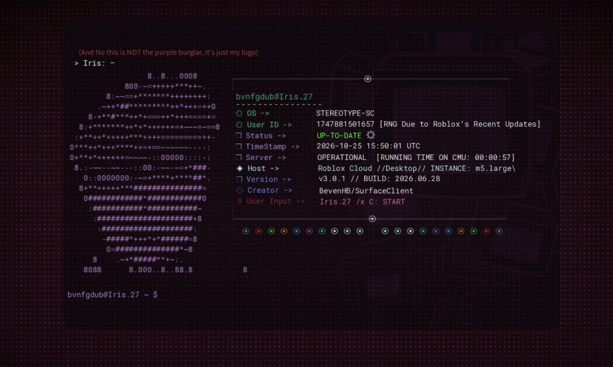

This requires a certain Hierarchy in studio to setup in order for this code to function properly,

-- also keep in mind that you must name everything EXACTLY (CapSensetive aswell) as the declared variable names, --

alongside the fact that you MUST have your own Image and Sound IDs,

[UPDATE] all the hierarchies are now in a folder, you must set up your own Exactly as you see in the images,

but currently you can only review, copy or just modify the code to your liking,

if you wish to convert this code to lua, you'll need a transpiler. guides on youtube are available for that. that's all; have a great day.

